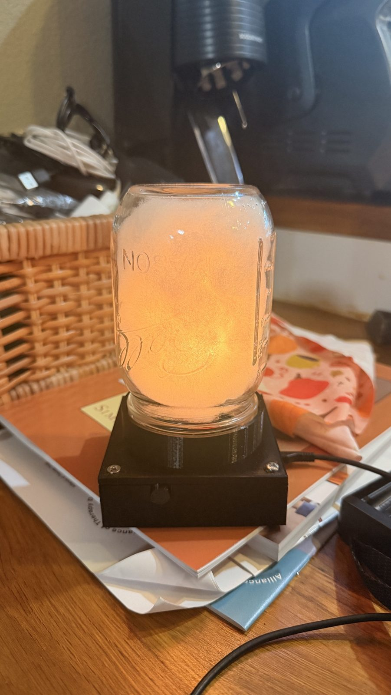
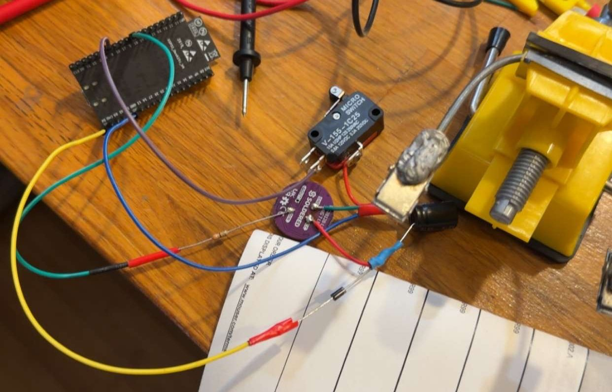
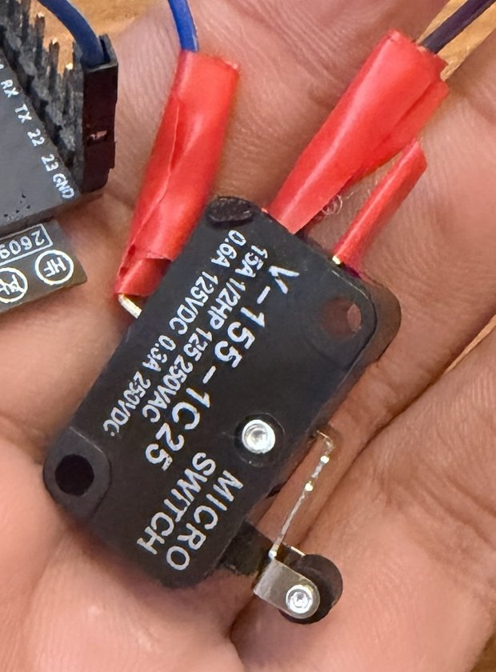
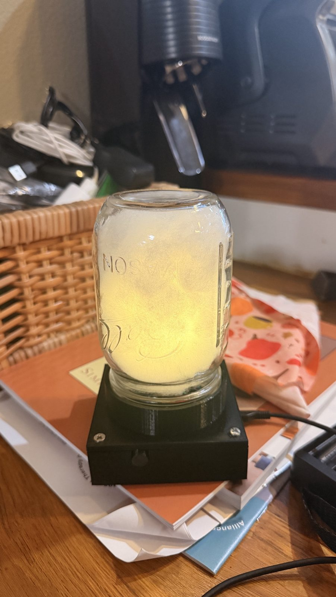

# Jar of Thoughts

A WiFi mason-jar lamp. One person presses a button in Telegram, the jar glows on the other person's desk; they press the jar and a message goes back. Built as a gift.



## How it works
- **ESP32 DevKitC-32E** drives a **7-LED WS2812B ring** and reads one microswitch.
- Control is through a **Telegram bot** (reply keyboard + inline color panel). No cloud service, no app.
- The receiver sets everything on a small web page on her own WiFi (`http://jar.local`): pulse colors, messages, idle glow, brightness, timezone, quiet hours.
- First-time WiFi is entered on a phone through a setup portal (WiFiManager), so no WiFi credentials are compiled in.

## Parts
| Part | Notes |
|---|---|
| ESP32 DevKitC-32E | classic ESP32, 2.4 GHz only |
| 7-LED WS2812B ring | 5 V, GRB order (Mouser 392-333055) |
| Omron V-155-1C25 micro switch | roller lever; see `cad/` |
| 330 Ω 1/4 W resistor | in series with the data line (CF1/4CT52A331J) |
| 1N4007 diode | in series with the ring's 5 V feed (see Wiring) |
| 1000 µF 16 V electrolytic capacitor | across the ring's 5 V / GND, close to the ring (ESH108M016AH2AA) |
| Regular-mouth mason jar + metal band | band is glued into the printed lid |
| Fiberfill / pillow stuffing | diffuses the light |
| M3 screws x4, USB cable + 5 V adapter | |

## Wiring
```
ESP32 GPIO18 ──[330 Ω]── ring DIN
ESP32 VIN (5 V) ──►|── ring 5V        (1N4007 in the 5 V feed)
1000 µF 16 V cap between ring 5V and GND, close to the ring
ESP32 GND ───────────── ring GND
ESP32 GPIO4 ── switch (COM and NO terminals) ── ESP32 GND     (internal pull-up, no resistor)
```
- Brightness is hard-capped at 40 % in firmware (`MAX_BRIGHTNESS 100`) to keep heat down.
- The switch uses the internal pull-up; press = pin pulled low.
- The 1000 µF / 16 V electrolytic across the ring's power pins soaks up inrush and LED current spikes. Mind the polarity (stripe = negative).
- The 1N4007 in the 5 V feed drops about 0.7 V, so the ring runs at roughly 4.3 V from USB 5 V. It also helps the ESP32's 3.3 V data signal: the ring needs roughly 0.7 × its supply voltage (about 3 V here) to read a high.



The 7-LED ring is the small round board; the resistor is on the data wire, the diode is in the 5 V feed, and the switch is wired to GPIO4 and ground.

## Firmware
1. Arduino IDE, board **ESP32 Dev Module**, partition scheme **No OTA (2MB APP/2MB SPIFFS)** (the sketch is ~98 % of the default partition).
2. Libraries: Adafruit NeoPixel, UniversalTelegramBot (Brian Lough), **ArduinoJson 6.21.x (not 7.x)**, WiFiManager (tzapu).
3. Create a bot with @BotFather, get your chat ID, copy `firmware/jar_of_thoughts/secrets.h.example` to `secrets.h` and fill it in.
4. Flash `firmware/jar_of_thoughts/jar_of_thoughts.ino`. `/status` in Telegram shows the build tag.

### Telegram commands
`Pulse` button, `/pulse <color|#hex|r g b>`, `/doubleclick enable|disable`, `/pulse2 [color]`, `/settings`, `/status`, `/log`.

### Button
short press = acknowledge / send "press" message · double press = night mode (or "double click" message when enabled) · hold 10 s = erase WiFi and return to setup.

## Enclosure (`cad/`)


Printed with **no supports**. Parts: `hz_tub.stl` (electronics box, print open side up), `hz_top.stl` (lid with a collar that holds the jar's metal band, print collar up), `hz_button_cap.stl` (print flat). The lid underside clamps the switch, four M3 screws close it. Everything is generated by `make_base_hz.py` (needs `trimesh`, `manifold3d`, `numpy`).

**Unverified dimensions:** band outer diameter (73.5 mm guess; measure yours), roller position on the switch and terminal clip length. Test-fit the lid and the tub before a full print.

## Setup for the recipient
See [docs/setup-guide.md](docs/setup-guide.md).

## Security notes
- Never commit `secrets.h`. If a bot token leaks, revoke it in @BotFather.
- The settings page is plain HTTP on the local network; set `SETTINGS_PASSWORD` if that matters to you.

## Build log / photos
Finished jar, idle glow (warm white):



Finished jar, pulse color:


The jar is flipped upside down on the printed base and filled with fiberfill, which spreads the ring's light.
